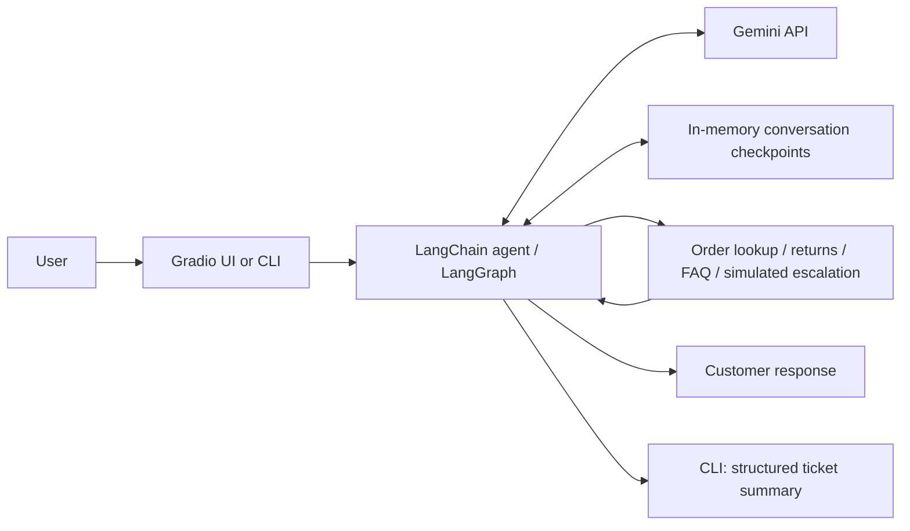

# AGENTIC AI - Chatbot

A tool-using customer-support chatbot that connects natural-language requests to explicit business rules. Built with **Python, LangChain, LangGraph, Google Gemini, and Gradio**, it helps customers of a fictional electronics retailer look up orders, check return eligibility, find policies, and request a simulated human handoff.

**Coursework attribution:** This project is based on exercises I completed in my Agentic AI class, particularly the W03b customer-support chatbot exercise. The original exercise and starter materials were provided as part of the course; this repository presents my completed work, refactored into a standalone application with additional testing and configuration. This repository contains the Python files needed to run and test the project; course notebooks, lecture materials, credentials, and notebook outputs are excluded.

## What it demonstrates

- **Tool calling:** the model selects among four typed tools rather than inventing order details.
- **Conversation memory:** LangGraph checkpoints preserve context within each conversation; browser sessions receive separate IDs.
- **Business-rule automation:** Python determines return eligibility using a 30-day policy, including boundary cases.
- **Structured output:** the command-line app generates a Pydantic-validated ticket summary when a conversation ends.
- **Usable interfaces:** a Gradio chat interface and a command-line entry point.
- **Testable design:** an injectable model enables offline tests of actual graph execution without API charges.

## Architecture



The model chooses actions; the tools supply facts and compute eligibility. The FAQ uses keyword matching, not vector retrieval. No external order system or human-support service is connected.

## Run locally

Requires Python 3.11+ and a Google Gemini API key with access to the configured model.

```bash
git clone https://github.com/alicanylmz/AGENTIC-AI-Chatbot.git
cd AGENTIC-AI-Chatbot
python3 -m venv .venv
source .venv/bin/activate
python -m pip install -r requirements.txt
cp .env.example .env
```

On Windows, activate with `.venv\Scripts\activate` and copy the example with `copy .env.example .env`.

Set `GOOGLE_API_KEY` in your local `.env`. `GEMINI_MODEL` defaults to `gemini-3.5-flash-lite`, the model used in the course project; change it to a tool-capable Gemini model available to your account if necessary. See [Google's model documentation](https://ai.google.dev/gemini-api/docs/models). API usage may incur charges.

```bash
python app.py
```

Open the local URL printed by Gradio, normally `http://127.0.0.1:7860`. The server binds to localhost and does not create a public share link.

For the command-line interface:

```bash
python -m agent.agent
```

Type `quit` to generate and print a structured ticket summary. Summaries are not written to disk.

## Try these conversations

| Request | Expected tool behavior |
| --- | --- |
| “Where is order HT-1002?” | Looks up the shipped mechanical keyboard. |
| “Can I return HT-1001?” | Reports eligibility: delivered 20 days before the demo date. |
| “Can I return HT-1004?” | Reports that the 30-day return window has expired. |
| “What about HT-1003?” | Uses the processing order; the return window has not started. |
| “What are your shipping and return policies?” | Retrieves both matching FAQ entries. |
| “I want to talk to a person.” | Generates a simulated escalation receipt; nobody is contacted. |

The synthetic dataset uses **September 25, 2026** as a fixed demo date so results do not change as the project ages. Clearing the browser conversation starts a new conversation ID.

## Tests

```bash
python -m unittest discover -s tests -v
```

Tests cover normalized and unknown order IDs, delivered/undelivered/expired returns, day 0/30/31 and future-date boundaries, FAQ matching, simulated escalation IDs, tool execution through the actual agent graph, thread isolation, and UI construction. GitHub Actions runs the same suite on pushes and pull requests.

These are offline tests using a deterministic fake model. They validate application wiring and rules, not Gemini response quality or live API availability. No accuracy or latency benchmark is claimed.

## Project layout

```text
app.py                    Gradio browser interface
agent/agent.py            Agent construction and CLI
agent/tools.py            Synthetic data and four tools
agent/prompts.py          Agent behavior instructions
agent/records.py          Structured ticket schema and extraction
tests/test_chatbot.py     Offline tests
.github/workflows/        Continuous integration
.env.example              Empty API-key template
requirements.txt          Runtime dependencies
```

## Scope and limitations

This is an educational portfolio prototype, not a production support service. Orders are fictional and shared demo data; there is no authentication or ownership verification. Memory lives in the server process and disappears on restart. Old checkpoints are retained until restart, even after clearing the UI. There are no real refunds, order updates, persistent ticket storage, or human notifications.

Messages and relevant tool outputs are sent to the configured Gemini API. Use synthetic inputs. The system prompt is a behavioral instruction, not an authorization boundary; deployment would require authentication, access control, rate limits, persistence, and additional evaluation.

## Credentials and attribution

Credentials belong in a local `.env` or deployment environment variables. `.env` files, private-key files, caches, and virtual environments are ignored by Git. The distributed `.env.example` has no credential value.

The starting point was the customer-support exercise in my Agentic AI coursework (`W03b`). This portfolio version reorganizes the application, adds explicit configuration, fixes conversation isolation, makes demo dates reproducible, clarifies simulated escalation, and adds automated checks. It does not claim the teaching exercise as an entirely original framework.

Framework references: [LangChain agents](https://docs.langchain.com/oss/python/langchain/agents), [LangGraph memory](https://docs.langchain.com/oss/python/langgraph/add-memory), and [Gradio](https://www.gradio.app/docs).
